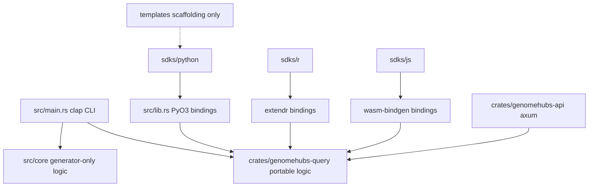

# CLI-first architecture

Status: accepted direction, 2026-11-18. Supersedes the templates-as-SDK-carriers
model in [multi-language-roadmap.md](multi-language-roadmap.md) where they conflict.
Read this before changing any SDK, template, CLI command, or shared core module.

---

## 1. Direction of travel

Rust is the single source of truth for behaviour. The CLI is the reference
interface. Language SDKs are thin, top-level packages that wrap the same Rust
logic. Templates become scaffolding only.

Principles:

1. **Rust first.** Logic is written once in Rust. Bindings (PyO3, extendr,
   wasm-bindgen) and the CLI are wiring only. No SDK re-implements validation,
   query building, URL building, parsing, reshaping, or pagination.
2. **CLI as the reference.** Every API capability should be reachable from the
   CLI with the same v3 YAML contract the SDKs use. The CLI is the oracle for
   parity tests.
3. **v3 is canonical.** The `SearchQuery` YAML (flat: `index`, `taxa`,
   `taxon_filter`, `rank`, `assembly_ids`, `sample_ids`, `attributes`, `fields`,
   `names`, `ranks`) plus a params YAML is the only input contract for new work.
   The v2 `--query` / `url=` path is legacy and kept only until removed.
4. **SDKs are packages, not templates.** Each language SDK moves to a top-level
   directory (target: `sdks/python/`, `sdks/r/`, `sdks/js/`). Templates keep only
   what generated projects need to scaffold themselves.
5. **One language at a time.** Each migration is gated by that language's parity
   tests. The old template path is removed only after the gate passes.
6. **Presentation stays in the language.** DataFrame conversion (pandas, polars,
   tibble), printing, and idiomatic naming are allowed in SDKs. Anything that
   changes query meaning, results, or validation is not.

---

## 2. Target layout and dependency direction

Rules implied by the diagram:

- `crates/genomehubs-query` is the only home for logic shared by the CLI, the
  API, and any SDK. It must not depend on `cli-generator` (the root crate).
- `crates/genomehubs-api` depends only on `genomehubs-query` (target state; see
  section 5).
- `src/core/` holds generator-only logic (codegen, config, runtime HTTP helpers
  for the CLI). If an SDK or the API needs it, it moves to the subcrate.
- `src/main.rs` and `src/lib.rs` contain wiring only.
- `src/generated/` is never edited by hand.

---

## 3. Coverage matrix (API v3 to CLI and SDK methods)

Status key: **yes** = covered via the v3 contract; **partial** = covered but
legacy transport, local-only, or incomplete; **no** = missing.

API paths (21) were verified against `crates/genomehubs-api/src/routes/*.rs`.
The older [v3-gap-analysis.md](v3-gap-analysis.md) has stale paths and should
not be used as the endpoint reference.

| API path                   | CLI                                                | Python                                                                  | R                            | JS                                          | Generated Rust client                  |
| -------------------------- | -------------------------------------------------- | ----------------------------------------------------------------------- | ---------------------------- | ------------------------------------------- | -------------------------------------- |
| `GET/POST /search`         | partial (`search`, GET + legacy v2 `url=` only)    | yes (`search`, `search_df`, `search_polars`, `search_all`)              | yes (`search`, `search_all`) | yes (`search`, `searchAll`)                 | yes (`search`, `search_all`)           |
| `POST /search/batch`       | no                                                 | yes (`search_batch`)                                                    | yes (`search_batch`)         | yes (`searchBatch`)                         | no (`msearch` exists; verify endpoint) |
| `GET/POST /count`          | partial (`count`, legacy v2 `url=` only)           | yes                                                                     | yes                          | yes                                         | yes                                    |
| `POST /count/batch`        | no                                                 | yes (`count_batch`)                                                     | yes (`count_batch`)          | yes (`countBatch`)                          | no                                     |
| `GET /lookup`              | yes (`lookup`)                                     | yes                                                                     | yes                          | yes                                         | yes                                    |
| `POST /lookup/batch`       | no                                                 | yes (`lookup_batch`)                                                    | yes (`lookup_batch`)         | yes (`lookupBatch`)                         | no                                     |
| `GET /record`              | no                                                 | yes (`record`)                                                          | yes (`record`)               | yes (`record`)                              | yes (`record`)                         |
| `POST /record/batch`       | no                                                 | yes (`record_batch`)                                                    | yes (`record_batch`)         | yes (`recordBatch`)                         | no                                     |
| `GET /summary`             | no                                                 | yes (`summary`)                                                         | yes (`summary`)              | yes (`summary`)                             | yes (`summary`)                        |
| `POST /summary/batch`      | no                                                 | no                                                                      | no                           | no                                          | no                                     |
| `POST /report`             | local only (`local-report`)                        | yes (`report`)                                                          | yes (`report`)               | yes (`report`)                              | yes (`report`)                         |
| `POST /report/batch`       | no                                                 | yes (`report_batch`)                                                    | yes (`report_batch`)         | yes (`reportBatch`)                         | no                                     |
| `POST /positional`         | no                                                 | yes (`positional`, `oxford`, `ribbon`, `painting`, `hybrid_positional`) | yes (same set)               | yes (same set, `hybridPositional`)          | yes (`positional`)                     |
| `GET /phylopic`            | no                                                 | yes (`phylopic`)                                                        | yes (`phylopic`)             | yes (`phylopic`)                            | no                                     |
| `POST /phylopic/batch`     | no                                                 | yes (`phylopic_batch`)                                                  | yes (`phylopic_batch`)       | yes (`phylopicBatch`)                       | no                                     |
| `GET /metadata`            | no                                                 | yes (`metadata`)                                                        | yes (`metadata`)             | yes (`metadata`)                            | no                                     |
| `GET /metadata/indices`    | no                                                 | yes (`indices`)                                                         | yes (`indices`)              | yes (`indices`)                             | no                                     |
| `GET /metadata/fields`     | partial (used internally by `describe`/`validate`) | partial (`fields`; `validate()` reads bundled JSON)                     | yes (`fields`)               | yes (`fields`; `validate()` has a fallback) | no (local `field_info`)                |
| `GET /metadata/ranks`      | no                                                 | yes (`ranks`)                                                           | yes (`ranks`)                | yes (`ranks`)                               | no                                     |
| `GET /metadata/taxonomies` | no                                                 | yes (`taxonomies`)                                                      | yes (`taxonomies`)           | yes (`taxonomies`)                          | no                                     |
| `GET /status`              | no                                                 | partial (`probe_api_capability` helper only)                            | no                           | no                                          | no                                     |

Local (non-API) CLI commands with no API path: `describe`, `validate`, `check`
(repo sync), `new`, `update`, `preview`, `local-report`.

Summary of gaps:

- **CLI:** 3 of 21 API paths are exposed. `search` and `count` use only the
  legacy v2 `url=` transport. This violates the pure v3 constraint and must be
  fixed first.
- **Missing everywhere:** `summary/batch`. No SDK or CLI method.
- **Missing in JS and R:** `status`. Python has only an internal probe.
- **Missing in CLI:** every batch path, `record`, `summary`, `report`,
  `positional`, `phylopic`, and all `metadata` routes.
- **Stale transport in SDKs:** Python `search_all` uses v2 `searchPaginated`.
  JS `validate()` calls `/api/v3/metadata/validation-config`, which the API does
  not serve (it falls back to local files). Python, R, and JS have three
  different `validate()` signatures.

---

## 4. Consolidation candidates

Each item needs a decision before implementation. Deletions require user
confirmation.

| #   | Item                                                                                                  | Evidence                                                                                                                                                                                                                                                                                              | Proposed action                                                                                                                                                                                                                                                 |
| --- | ----------------------------------------------------------------------------------------------------- | ----------------------------------------------------------------------------------------------------------------------------------------------------------------------------------------------------------------------------------------------------------------------------------------------------- | --------------------------------------------------------------------------------------------------------------------------------------------------------------------------------------------------------------------------------------------------------------- |
| C1  | `src/core/query/validation.rs` (about 1063 lines)                                                     | Not dead. Copied into generated projects by `copy_embedded_modules` and `copy_r_embedded_modules` in `src/commands/new.rs`. Imported by `templates/rust/sdk.rs.tera`, `templates/rust/main.rs.tera`, and `templates/rust/field_meta.rs.tera`. Duplicates `crates/genomehubs-query/src/validation.rs`. | **Retained pending template migration (Phase 5).** Delete with the templates.                                                                                                                                                                                   |
| C2  | `src/core/snippet.rs` (about 279 lines) vs `crates/genomehubs-query/src/snippet.rs` (about 185 lines) | Not dead. Copied into generated projects. Imported by `templates/rust/lib.rs.tera`, `templates/rust/main.rs.tera`, and `templates/r/lib.rs.tera` (`QuerySnapshot`, `SnippetGenerator`). PyO3 `render_snippet` in `src/lib.rs` uses the root copy.                                                     | **Retained pending template migration (Phase 5).** Move `QuerySnapshot` family into the subcrate, then delete the root copy with the templates.                                                                                                                 |
| C3  | `src/core/query_builder.rs` (about 1300 lines), `src/core/attr_types.rs`                              | `build_search_body`, `build_count_body`, `SearchBodyInput`, and `TypesMap` are ES-body builders used by `genomehubs-api`.                                                                                                                                                                             | **Done.** Moved to `genomehubs-query` (`query_builder.rs`, `attr_types.rs`). The API no longer depends on the root crate. The HTTP `attr_types()` fetch was dropped as dead; the API has `fetch_attr_types`.                                                    |
| C4  | `src/core/count.rs` (about 181 lines)                                                                 | Direct ES count. Used only by `tests/integration/es_integration.rs`.                                                                                                                                                                                                                                  | **Done.** Deleted with `tests/integration/`. The integration file was not a test target and was already broken.                                                                                                                                                 |
| C5  | `src/core/process_hits.rs` (about 581 lines)                                                          | Used only by `tests/process_hits.rs`. Overlaps subcrate `parse.rs`.                                                                                                                                                                                                                                   | **Done (deleted).** Checked against `parse.rs`: nothing to merge. The deleted code parsed v2-shaped `inner_hits` for `names` and `identifiers`. The v3 API returns `taxon_names` through `_source` (`include_taxon_names`), so no v3 consumer needs this logic. |
| C6  | Record reshaping (flat/tidy)                                                                          | `to_tidy_records` is exposed in `src/lib.rs`. R (`templates/r/query.R`) and JS (`templates/js/query.js`) also reshape records in template code.                                                                                                                                                       | Verify each SDK. Route all reshaping through the Rust function.                                                                                                                                                                                                 |
| C7  | Pagination (`search_all`)                                                                             | Logic is repeated in Python, R, JS, and `templates/rust/client.rs.tera` (about line 471).                                                                                                                                                                                                             | Put cursor and next-request logic in the subcrate. SDKs keep only the HTTP loop.                                                                                                                                                                                |
| C8  | Batch input normalisation                                                                             | R `normalise_one` (`templates/r/query.R`) and Python `lookup_batch` item handling both normalise string or dict items.                                                                                                                                                                                | Move to a subcrate helper.                                                                                                                                                                                                                                      |
| C9  | Report config (`describe_report_yaml`, `validate_report_yaml`, axis boundaries)                       | Subcrate has validators. Report builders in Python, R, and JS also build config.                                                                                                                                                                                                                      | Builders become thin; construction and validation live in the subcrate.                                                                                                                                                                                         |
| C10 | Field metadata loading                                                                                | `field_meta_map` (subcrate), the API ES-JSON path, the CLI `/metadata/fields` path, and bundled JSON in Python `validate()`.                                                                                                                                                                          | One `FieldDef` loader in the subcrate.                                                                                                                                                                                                                          |
| C11 | Generated Rust client (`templates/rust/client.rs.tera`, about 900 lines)                              | Duplicates request and response logic from `src/core/runtime_query.rs`.                                                                                                                                                                                                                               | Make it a thin wrapper once the CLI is v3-first.                                                                                                                                                                                                                |

---

## 5. Migration plan

Phases are ordered. Later phases start only after the earlier ones pass their
gates.

**Phase 0 (this note).** Direction, coverage matrix, and consolidation list.
Gate: user review.

**Phase 1: Rust core and CLI (no SDK changes).**

1. Confirm and resolve C1 to C5 (deletions need approval).
2. Move ES-body builders (C3) into `genomehubs-query`. The API then depends only
   on the subcrate. Gate: `cargo test --workspace` and `cargo clippy` pass. The
   API builds without the root crate.
3. Add v3 transport to CLI `search` and `count`: `--query-yaml` and
   `--params-yaml`, sent as POST `/api/v3/search` and `/api/v3/count` with JSON
   `{query_yaml, params_yaml}`. Keep `--query` as legacy. Gate: smoke test with
   a flat v3 YAML (`taxa` as a list, not a map).
4. Add missing CLI coverage per the matrix, starting with `record`, `summary`,
   `report`, `positional`, `phylopic`, `metadata`, and `status`. Batch shape
   needs a decision (see section 7).
5. Add `status` as a CLI command and SDK method in R and JS. Decide whether
   `summary/batch` is needed. It has no SDK or CLI method today, and the API
   route is the only existing implementation. Confirm with the user before
   changing any API route.

**Phase 2: Python SDK (first language).**

- Move the SDK from `templates/python/query.py.tera` to `sdks/python/`. Keep
  DataFrame conversion in Python. Route validation, query building, and
  pagination through PyO3.
- Parity gate: `tests/python/test_sdk_parity.py` and `pytest tests/python/`
  pass, plus `bash scripts/dev_site.sh --python goat`.
- Then delete the Python logic from the template. The template keeps only
  scaffolding.

**Phase 3: R SDK.** Same pattern with extendr. Parity gate:
`tests/r/test_sdk_fixtures.R` and the R parity tests.

**Phase 4: JS SDK.** Same pattern with wasm. Fix the stale `validation-config`
route and `/v2/search` references during the move. Parity gate: JS fixture
tests and a wasm rebuild (`dev_site.sh` rebuilds wasm by default).

**Phase 5: Retire template logic.** Delete `templates/*` language logic. Keep
scaffolding only. Remove the `enabled_sdks` template switching when no language
depends on it.

Proposed language order is Python, then R, then JS. Python has the most mature
bindings and parity tests. R and JS depend on the same Rust surface, so they
benefit from the Python work.

---

## 6. Rules for future work

- **New capability:** subcrate function, then CLI command, then binding
  (PyO3, extendr, or wasm), then thin SDK method, then docs. In that order.
- **No SDK-only logic** except presentation (DataFrame, printing, idiomatic
  naming).
- **Every SDK method maps to a CLI command or to a documented presentation
  helper.** If neither exists, add the CLI command first.
- **v3 only for new code.** Do not add `url=` or `searchPaginated` calls.
- **Stale references to avoid:** `/v2/search`, `/api/v3/metadata/validation-config`,
  and the `searchPaginated` method. Verify paths against the route files in
  `crates/genomehubs-api/src/routes/`, not against the gap-analysis doc.
- **Before deleting a module:** search `tests/`, `examples/`, `crates/`, and
  `templates/` for references.
- **Parity tests are the gate.** A language is not done until its fixture tests
  and parity tests pass with the same v3 inputs as the CLI.
- **Agent logs:** significant migration steps get an entry under `agent-logs/`.

---

## 7. Decisions

Recorded 2026-11-18 after user review.

1. **Batch CLI shape: decided.** Batch is a flag on the base command (for
   example `count --batch file.json`). No separate `*-batch` subcommands.
2. **Deletions C1, C2, C4, C5: approved.** Delete the dead or duplicate modules.
   Move the `QuerySnapshot` family into the subcrate before deleting the root
   snippet module (C2). C3 (move ES-body builders into the subcrate) is part of
   Phase 1.
3. **Language order: decided.** Python, then R, then JS.
4. **Default transport for CLI `search` and `count`: decided.** v3 POST with
   `query_yaml` and `params_yaml`. The `--query` v2 path stays as legacy.

Phase 1 status (2026-11-18): C3, C4, and C5 are done. The API no longer depends on
the root crate. C1 and C2 are retained until template migration (Phase 5), per
user decision. Step 3 (v3 transport for CLI `search` and `count`) is next and
needs user approval for the flag names before implementation. Batch flags come
after the v3 transport is in place.
